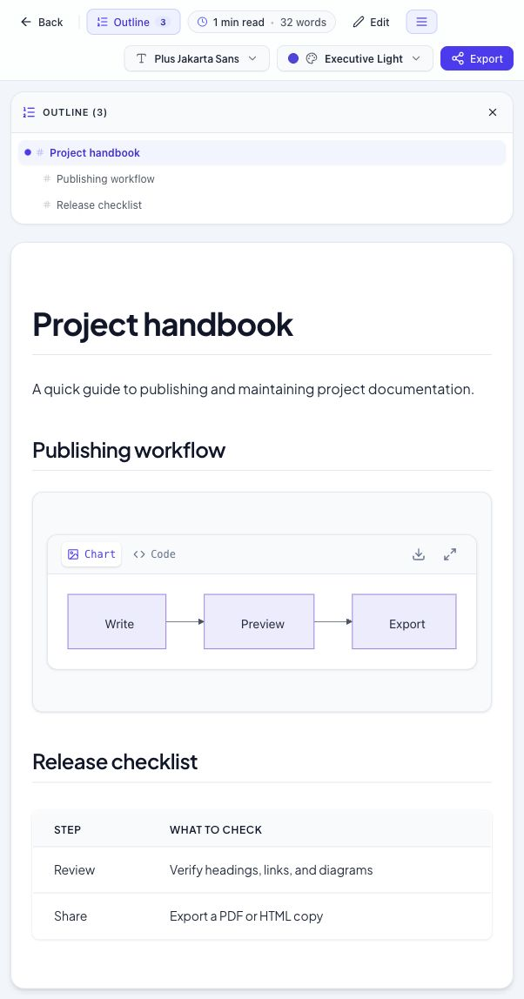

# MD Studio

MD Studio is a browser-based Markdown reader and editor. Paste Markdown, open a file or folder, import a ZIP archive, or browse the Markdown files in a public GitHub repository.



## What you can do

- Preview tables, task lists, syntax-highlighted code, and interactive Mermaid diagrams.
- Edit Markdown alongside a live preview and navigate longer documents with the outline.
- Customize the theme, font, and reading width.
- Export a document as PDF or HTML, or download a Mermaid diagram as PNG.

Local documents are processed in your browser. GitHub imports fetch public files directly from GitHub.

## Run locally

Use [Bun 1.4.4](https://github.com/oven-sh/bun/releases/tag/bun-v1.4.4), the version pinned in `package.json`.

```sh
bun install --frozen-lockfile
bun run dev
```

Open [localhost:3000](http://localhost:3000). No API key or `.env` file is required.

## Deploy to Cloudflare Workers

Connect this repository in **Workers & Pages → your Worker → Settings → Build**.

| Setting | Value |
| --- | --- |
| Root directory | `/` |
| Build command | `bun run build` |
| Deploy command | `npx wrangler deploy` |
| Build variables | None required |

Vite builds the site into `dist/`. Wrangler serves that directory as static assets. The name in `wrangler.jsonc` defaults to `md-studio-v1`. If your Worker has a different name, use its dashboard name in that file.

If the build log still shows an older Bun version, set `BUN_VERSION` to `1.4.4` under **Settings → Build → Build Variables and Secrets**, then retry the build. [Cloudflare build image documentation](https://developers.cloudflare.com/workers/ci-cd/builds/build-image/#overriding-default-versions)
